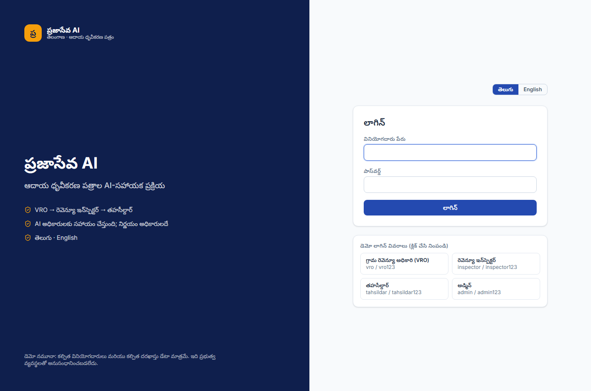
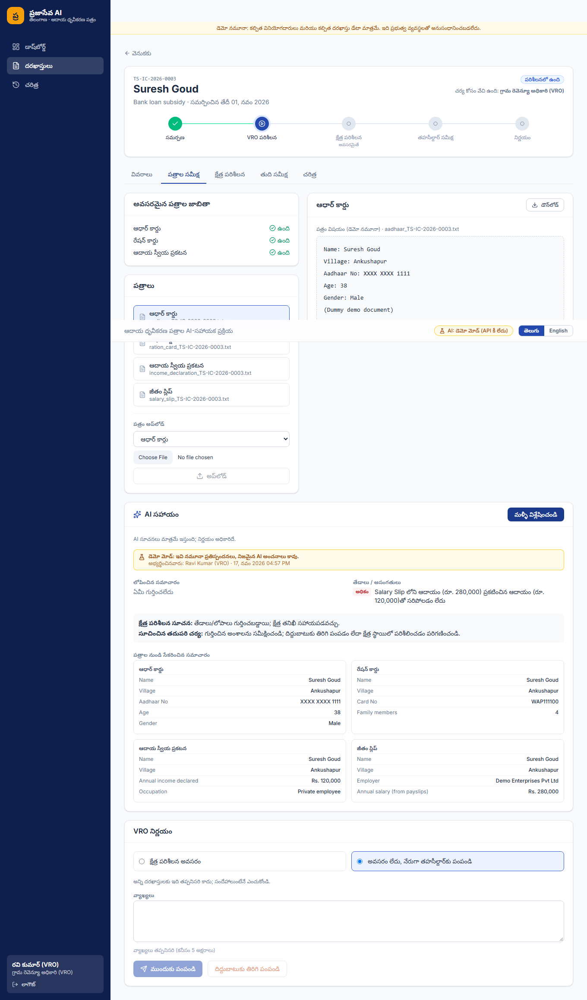
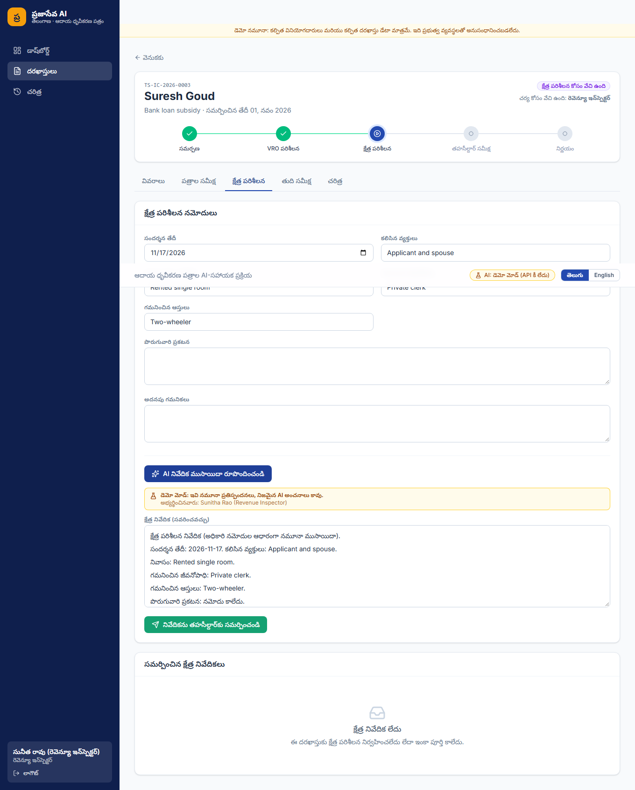
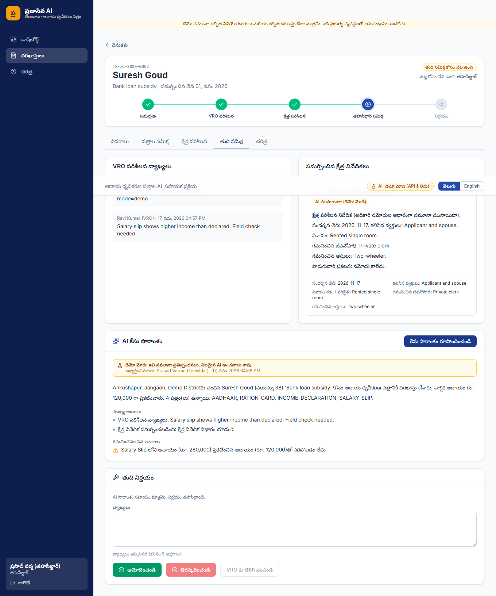

# PrajaSeva AI (ప్రజాసేవ AI)

A Telugu-first, AI-assisted workflow prototype for processing **Income Certificate** applications in Telangana, built for the Kenpath Full Stack AI Engineer assignment.

> **Academic/demo prototype.** It is **not** integrated with any Telangana government system. All users, applications, documents and "citizens" are fictional dummy data, and authentication is a demo implementation. **Not for production use.**



## Problem statement
An Income Certificate application passes through several officers. Each must read documents, spot missing or inconsistent information, write reports and summarise the case for the next person. The work is slow and error-prone, and mostly text.

## Target users
| Role | Responsibility in this app |
|---|---|
| VRO (Village Revenue Officer) | Initial scrutiny; decides whether field verification is needed; forwards or returns the application |
| Revenue Inspector | Field verification and report submission (only for applications the VRO sent for it) |
| Tahsildar | Final decision: approve / reject / return to VRO |
| Admin | Manages demo users and records; simulates applicant resubmission; archives records |

## Solution and workflow
```
Submitted ─▶ VRO scrutiny ─┬─▶ Field verification (Revenue Inspector) ─┐
                           │     (only if the VRO decides it is needed) │
                           ├────────────────────────────────────────────┴─▶ Tahsildar ─▶ Approved / Rejected
                           └─▶ Returned for correction ─▶ (resubmit) ─▶ Submitted       └▶ Returned to VRO
```
- Field verification is **conditional**: the VRO chooses; the app does not assume it is legally required for every case.
- Each action checks **both** the caller's role **and** the application's current status on the server, so direct API calls cannot skip stages (invalid transitions return 409, wrong role 403).
- Every transition (action, user, role, remarks, previous/new status, time) is written to an append-only audit history. There are no API endpoints that edit or delete history; "delete" by the admin is a **soft archive** that keeps the history and adds an `ARCHIVED` entry.
- UI is Telugu-first with an English toggle.

| VRO: documents + AI analysis | Inspector: field report | Tahsildar: final review |
|---|---|---|
|  |  |  |

More: [dashboard (te)](docs/screenshots/02-dashboard-vro-te.png) · [dashboard (en)](docs/screenshots/08-dashboard-en.png) · [history](docs/screenshots/06-history.png) · [admin users](docs/screenshots/09-users.png) · [admin detail](docs/screenshots/11-admin-detail.png) · [mobile](docs/screenshots/10-mobile.png) · [mobile detail](docs/screenshots/14-mobile-detail.png)

## AI integration
**Provider implemented: Anthropic Messages API only** (`https://api.anthropic.com/v1/messages`, called with `httpx` in `backend/app/ai_service.py`). No other provider is implemented.

| Feature | What it does |
|---|---|
| Document extraction | Pulls key fields from each document |
| Missing / discrepancy detection | e.g. salary slip income higher than declared income |
| Field report drafting | Turns the inspector's observations into a report draft the inspector edits |
| Case summary | Gives the Tahsildar the facts, VRO remarks, field report and open concerns |

**AI assists only.** No AI output approves, rejects or moves an application; every transition is an officer's explicit action. Each AI run is stored in `ai_logs` (mode, model, output, user) and shown with a banner.

**Modes**
- **Live**: used only when `ANTHROPIC_API_KEY` is set. The top bar shows "AI: Live · model".
- **Demo**: no key. Responses come from simple rules/templates over the demo data (not an LLM) and are labelled "DEMO MODE: sample response, not an actual AI prediction" in the UI, API (`mode: "demo"`) and database.
- **No silent fallback.** If a live call fails (invalid key, network error, non-JSON or wrongly-shaped output), the API returns HTTP 502 with the reason, nothing is stored, and the UI shows the error. Fake output is never substituted. Live responses are schema-validated before being stored or shown.

**Limitations and caveats**
- **The live path has NOT been tested against the real Anthropic API** (no key was available). It is covered only by unit tests with the HTTP call mocked. The default model ID `claude-sonnet-5-5` is configurable via `LLM_MODEL` and was not verified against the live API.
- With a live key, document text and applicant details are sent to a third-party API. Do not use real citizen data with this prototype.
- Document text is passed to the model, so a malicious document could attempt prompt injection. Output is only advisory and goes through validation, but it can still be wrong or misleading; officers must verify it.
- Extraction works on text only: uploaded `.txt` content is analysed; PDFs/images are stored but not read (no OCR).
- AI accuracy and bias have not been evaluated.

## Architecture
- **Frontend:** React 19 + TypeScript + Tailwind v4 (Vite). Dev server proxies `/api` to the backend. Own i18n dictionary (Telugu/English), context providers for auth and toasts.
- **Backend:** FastAPI + SQLAlchemy 2 + SQLite (`backend/data/prajaseva.db`; uploads in `backend/data/uploads/`).
- **Auth:** JWT (HS256, 8h expiry; `exp` and `sub` required). The user's **role is read from the database on every request**, not trusted from the token. Passwords are PBKDF2-HMAC-SHA256 (100k iterations, random salt). Disabled users are rejected.
- **RBAC:** `require_roles(...)` dependency on every protected route.
- **Tables:** users, applications, documents, workflow_tasks, verification_reports, ai_logs, audit_logs.

```
prajaseva-ai/
├── frontend/        React app (pages/, components/, i18n.tsx, api.ts)
├── backend/
│   ├── app/         main, database, models, schemas, auth, routes, ai_service, seed
│   ├── tests/       test_api.py (workflow), test_security.py (RBAC, uploads, tokens, live-AI errors)
│   ├── data/        SQLite DB + uploads (git-ignored; created on first run)
│   └── requirements.txt
└── docs/screenshots/
```

### Technology choices and tradeoffs
| Choice | Why | Tradeoff |
|---|---|---|
| SQLite | Zero setup, required by the brief | Single-writer; no migrations (schema is created on start; delete the DB file after model changes) |
| Hand-rolled PBKDF2 + PyJWT | Few dependencies, standard primitives | bcrypt/argon2 would be preferable in production |
| Anthropic via plain `httpx` | Small, explicit, easy to mock in tests | No SDK retries/streaming |
| Demo-mode rules/templates | App fully usable and testable offline | Not real AI; kept visibly labelled |
| Role-queue assignment | Simple; matches the demo | Not per-officer (see limitations) |
| Soft-archive instead of delete | Preserves the audit trail | Archived records stay in the DB |
| Own i18n dictionary | No heavy dependency, Telugu default | No pluralisation/ICU features |

## Demo credentials (demo only, not production)
| Role | Username | Password |
|---|---|---|
| VRO | `vro` | `vro123` |
| Revenue Inspector | `inspector` | `inspector123` |
| Tahsildar | `tahsildar` | `tahsildar123` |
| Admin | `admin` | `admin123` |

The login page lists these for convenience. Set `SHOW_DEMO_CREDENTIALS=false` to hide them (the endpoint then returns an empty list).

## Local installation
Requires Python 3.10+ and Node 18+.

**Backend** (port 8000):
```bash
cd backend
python -m venv .venv
.venv/Scripts/activate            # Windows;  source .venv/bin/activate on macOS/Linux
pip install -r requirements.txt
uvicorn app.main:app --reload --port 8000
```
The DB is created and seeded with 11 dummy applications on first start. Admin → Users → "Reset demo data" restores it (this also wipes history).

**Frontend** (port 5173), second terminal:
```bash
cd frontend
npm install
npm run dev
```
Open http://localhost:5173. Production build: `npm run build`.

### Suggested walkthrough
1. `vro`: open **Suresh Goud** (TS-IC-2026-0003) → *Run AI analysis* (flags salary slip 280000 vs declared 120000) → forward with "field verification needed".
2. `inspector`: open it, add observations, generate the draft, edit, submit.
3. `tahsildar`: generate the summary, then approve / reject / return.
4. Check the **History** tab; toggle the language.

## Environment configuration
Copy `backend/.env.example` to `backend/.env` (git-ignored, never commit):

| Variable | Default | Purpose |
|---|---|---|
| `ANTHROPIC_API_KEY` | empty | Empty = demo AI mode. Set = live Anthropic calls |
| `LLM_MODEL` | `claude-sonnet-5-5` | Anthropic model ID (unverified default) |
| `JWT_SECRET` | fixed demo value | **Set a long random value.** The backend prints a warning at startup if the demo secret is in use |
| `SHOW_DEMO_CREDENTIALS` | `true` | Show demo credentials on the login page |

CORS only allows `http://localhost:5173` and `http://127.0.0.1:5173`.

## Security summary
- JWT expiry/signature/claims validated; forged, unsigned (`alg: none`), expired and exp-less tokens rejected.
- RBAC on every protected route, verified by a test that lists **every** `/api` route and fails if a new one is not in the matrix.
- Uploads: extension allow-list (`.txt .pdf .png .jpg .jpeg`), 2 MB limit, document-type allow-list, empty files rejected, stored under a generated name (user filename is stripped of path components).
- Document download requires a valid token.
- `.env`, the SQLite DB and uploaded files are git-ignored (verified in a scratch repo).

## Testing
```bash
cd backend
pytest -q          # 31 tests
cd ../frontend
npm run build      # type-check + production build
```
Tests run against an isolated temp database with no API key. They cover login/JWT, an RBAC matrix (401/403 for every endpoint/role), the full workflow with and without field verification, return/resubmit audit entries, invalid transitions, upload validation, token forgery, archive keeps history, history is read-only, and live-AI error handling (mocked HTTP).

## Known limitations
- **Assignment is by role queue, not per officer.** Any Revenue Inspector can act on any application awaiting field verification (the *stage* is enforced, the *individual* is not). Per-mandal/village assignment is future work.
- Any authenticated officer can read any application and document (no village/mandal scoping).
- No login rate limiting or lockout; JWT is stored in browser localStorage (XSS-exposed); no refresh tokens or logout revocation.
- Demo credentials are public; "Reset demo data" is an admin action that wipes history (demo only).
- Applicant resubmission is simulated by an admin button; there is no applicant portal.
- No OCR; no verification against government registries.
- Network-error text shown by the UI is English only.
- No SQL migrations; after model changes delete `backend/data/prajaseva.db`.
- **Live AI is untested; nothing has been deployed.**

## Future improvements
- Official identity/SSO, real intake, an applicant portal and certificate generation with digital signature.
- Per-officer / per-mandal assignment, SLA timers, notifications.
- OCR for scanned documents; registry checks.
- bcrypt/argon2, HttpOnly cookies, rate limiting, Alembic migrations, PostgreSQL.
- Evaluation of AI extraction accuracy and bias before any real use.
